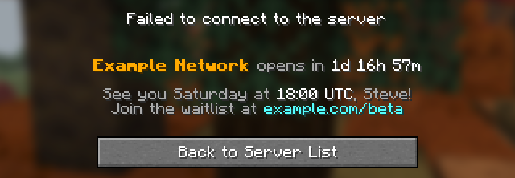

# Fake Minecraft Server

[](https://github.com/nathan818fr/fake-minecraft-server/actions/workflows/ci.yaml)
[](https://github.com/nathan818fr/fake-minecraft-server/tags)
[](https://github.com/nathan818fr/fake-minecraft-server/pkgs/container/fake-minecraft-server)
[](LICENSE)

A lightweight server that answers the Minecraft server list, and kicks every
player who tries to join with a message of your choice. Show a closed server,
a maintenance screen, a countdown to your launch, or the live status of your
real servers, to every client from Beta 1.8 to the latest snapshots.


## Features

- **Every client.** Server list pings and logins from Beta 1.8 to the latest
  snapshots, legacy formats included. Clients see the server as compatible,
  or a version name in red, such as `Maintenance`, if you prefer.
- **The whole status.** Message of the day as text or JSON text components,
  icon, player counts, the lines shown on hover, and any other field, such as
  the mod lists of modded servers.
- **Live status of real servers.** Show the status of your servers while they
  answer, found by their SRV records like clients do, and your own when they
  are down.
- **Rules.** Show each client the server it should see: by the address it
  connected to, its version, its network, or whether it is modded, with
  fallbacks from one server to the next.
- **Scripting.** Compute statuses and kick messages for each client with
  [Starlark](https://github.com/bazelbuild/starlark), a small Python-like
  language, checked at startup and bounded at runtime.
- **Built for production.** A single static binary, released as a container
  image built from `scratch` that runs as a non-root user. Hot reload on
  `SIGHUP`, graceful shutdown, a health check command, several listeners, Unix
  sockets and the PROXY protocol.
- **Abuse resistant.** Strict protocol parsing, timeouts, limits per address
  and in total, and rate-limited logs that clients cannot forge.
- **Useful logs.** One line per connection, in text or JSON, with what each
  client sent.

## Quick start

Run the container image, with the server configured by a single variable:

```shell
docker run --rm -p 25565:25565 \
  -e FMS_SERVERS_DEFAULT='{ status: { description: "§6My Server §7is under maintenance", version: { name: "§cMaintenance", protocol: -1 } }, kick: "§cBack soon!" }' \
  ghcr.io/nathan818fr/fake-minecraft-server:v2
```

Then add `localhost` to your server list. For more than a status and a kick
message, write a [configuration file](docs/configuration.md):

```yaml
# config.yaml
servers:
  default:
    status:
      description: "§6My Server §7is under maintenance\n§7Back §fSaturday §7at §f18:00 UTC"
      # favicon: icon.png # A 64×64 PNG file, or a data:image/png;base64 URI.
      version: { name: "§cMaintenance", protocol: -1 }
      players:
        max: 0
        online: 0
        sample:
          - { name: "§7News: §bexample.com", id: 00000000-0000-0000-0000-000000000000 }
    kick:
      text: "We are under maintenance, back on Saturday.\n\n"
      color: gold
      extra: [{ text: "News on example.com", color: gray }]
```

```shell
docker run --rm -p 25565:25565 \
  -v "$PWD:/config:ro" -e FMS_CONFIG_FILE=/config/config.yaml \
  ghcr.io/nathan818fr/fake-minecraft-server:v2
```

See [Getting started](docs/getting-started.md) for Compose, and
[Deployment](docs/deployment.md#without-a-container) to run it without a
container.

## Examples



[`examples/`](examples) holds complete, commented configurations, tested with
every change: a [maintenance screen](examples/maintenance.yaml), a
[launch countdown](examples/opening-soon.yaml) that greets each player by
name, a [network](examples/network.yaml) with one server per address, and
[two real networks added up](examples/hydonut.yaml).

## Documentation

- [Getting started](docs/getting-started.md): install, run, reload and stop
- [Configuration](docs/configuration.md): every setting, as a file or as
  environment variables
- [Rules](docs/rules.md): which server each client sees
- [Scripting](docs/scripting.md): statuses and messages computed for each
  client
- [Deployment](docs/deployment.md): without a container, listeners, proxies,
  firewalls and resources
- [Logs](docs/logs.md): formats, and the line of each connection
- [Upgrading from v1](docs/upgrading-from-v1.md)

## Project

The [goals](GOALS.md) of the project say what it does and does not do.
Changes are listed in the [changelog](CHANGELOG.md), and releases follow
[semantic versioning](https://semver.org). Contributions are welcome, see
[contributing](CONTRIBUTING.md).

Fake Minecraft Server is released under the [MIT License](LICENSE). It is not
an official Minecraft product, nor approved by or associated with Mojang or
Microsoft.
