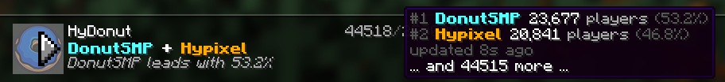

# Scripting

Scripts compute what the server answers, for each client: whether a rule
applies, the status in the server list, the kick message. They are written in
Starlark, a language like Python (see [The language](#the-language)).

| Setting                               | Holds                                                                  |
| ------------------------------------- | ---------------------------------------------------------------------- |
| [`rules[].when`](rules.md#conditions) | An expression that returns `True` or `False`: whether the rule applies |
| [`script`, `script_file`](#scripts)   | Functions and constants that the other scripts can use                 |
| [`servers.*.ping_script`](#hooks)     | An expression that can answer status requests in place of the status   |
| [`servers.*.join_script`](#hooks)     | An expression that can answer players in place of the kick message     |

For example, [`examples/opening-soon.yaml`](../examples/opening-soon.yaml)
puts a countdown to an opening in the kick message, with the name of each
player.

- [The language](#the-language)
- [client](#client)
- [ctx](#ctx)
- [server](#server)
- [Functions](#functions)
- [Scripts](#scripts)
- [Hooks](#hooks)
- [Checks and failures](#checks-and-failures)
- [Good practices](#good-practices)
- [Stability](#stability)

## The language

Scripts follow the
[Starlark specification](https://github.com/google/starlark-go/blob/master/doc/spec.md),
with `set`, `while` loops, recursion, and `if` and `for` at the top level
enabled. Strings are bytes, in UTF-8: `len("§c")` is 3.

## client

`client` is the client being answered, with the values it sent, as it sent
them, named like the fields of [logs](logs.md#connection-lines):

| Field                        | Description                                                                        | When unknown       |
| ---------------------------- | ---------------------------------------------------------------------------------- | ------------------ |
| `client.request`             | `"ping"` for status requests, `"join"` for players who try to join                 | -                  |
| `client.transferred`         | Whether the player was transferred from another server (1.20.5+)                   | `False`            |
| `client.host`, `client.port` | The host and port that the client connected to                                     | `""`, `0`          |
| `client.host_extra`          | What modded clients and proxies add after the host, such as `"FML3\x00"` for Forge | `""`               |
| `client.protocol`            | The protocol version of the client                                                 | `-1`               |
| `client.legacy`              | Whether the client is older than 1.7                                               | -                  |
| `client.legacy_ping_version` | The format of legacy pings: `"beta-1.3"`, `"1.4-1.5"` or `"1.6"`                   | `""`               |
| `client.ip`                  | The address of the client, or the one of its PROXY protocol header                 | `""` (Unix socket) |
| `client.listener`            | The address that the client connected to, as logged by `listening`                 | -                  |
| `client.username`            | The username that the player sent (joins)                                          | `""`               |
| `client.uuid`                | The UUID that the player sent (joins, 1.19.3+)                                     | `""`               |

Unknown values are `""`, `0` or `-1`, never `None`.

## ctx

`ctx` is the request being answered. It exists only while a client is
answered, so functions that need it take it as an argument:

| Method              | Returns                                                          |
| ------------------- | ---------------------------------------------------------------- |
| `ctx.upstream(id)`  | The upstream with the ID `id` (see below)                        |
| `ctx.upstreams()`   | All the upstreams, sorted by ID                                  |
| `ctx.server(id)`    | The [server](#server) with the ID `id`                           |
| `ctx.servers()`     | All the servers, sorted by ID                                    |
| `ctx.now()`         | The time of the request, in UTC, the same at each call during it |
| `ctx.random()`      | A random float, from 0 included to 1 excluded                    |
| `ctx.randint(a, b)` | A random int, from `a` to `b`, both included                     |
| `ctx.choice(seq)`   | A random element of `seq`, a list or a tuple                     |

An ID that no upstream or server has is an error: at startup when it is
written as text, such as `ctx.upstream("lobby")`, or else when the script runs.

An upstream has:

| Attribute    | Value                                                                                  |
| ------------ | -------------------------------------------------------------------------------------- |
| `id`         | Its ID                                                                                 |
| `address`    | Its address, as configured                                                             |
| `status`     | Its last status, as a dict in the order of its JSON, or `None` while it is unavailable |
| `latency_ms` | The latency of the ping of its last successful poll, or `None` before any              |
| `age_ms`     | How long ago that poll was, or `None` before any                                       |

Each request reads each upstream once, when first used, so that its
conditions, hooks and answer see the same state.

Random numbers change at each request. For a tip that changes every 30
seconds, the same for everyone, use `TIPS[ctx.now().unix // 30 % len(TIPS)]`;
for the same tip for each client, `TIPS[fms.bucket(client.ip, len(TIPS))]`.

## server

In hooks, `server` is the server that the hook belongs to, and
`ctx.server(id)` gives any server:

| Attribute       | Value                                                                              |
| --------------- | ---------------------------------------------------------------------------------- |
| `id`            | Its ID                                                                             |
| `status`        | The status it shows without hooks: its upstream's while available, or else its own |
| `static_status` | Its own status                                                                     |
| `upstream`      | The ID of its upstream, or `""`                                                    |
| `kick`          | Its kick message, as a text component                                              |

A server without a status or a kick message has the built-in ones.

## Functions

Besides Starlark's
[built-in functions](https://github.com/google/starlark-go/blob/master/doc/spec.md#built-in-constants-and-functions)
and [methods](https://github.com/google/starlark-go/blob/master/doc/spec.md#built-in-methods),
scripts can call these, under `fms.`:

| Function                             | Returns                                                                                                                               |
| ------------------------------------ | ------------------------------------------------------------------------------------------------------------------------------------- |
| `fms.match_host(host, pattern, ...)` | Whether `host` matches one of the patterns, like the [`host`](rules.md#hosts) of rules                                                |
| `fms.in_network(ip, network, ...)`   | Whether `ip` is in one of the networks: CIDR prefixes or addresses. `""` is in none                                                   |
| `fms.matches(text, regexp)`          | Whether `text` matches the [regular expression](https://github.com/google/re2/wiki/Syntax), anywhere unless anchored with `^` and `$` |
| `fms.bucket(value, n)`               | The bucket of the string `value` among `n`, from `0` to `n - 1` (see [Splitting clients](rules.md#splitting-clients))                 |
| `fms.merge(base, patch)`             | `base` merged with `patch`: dicts merge, `None` removes a member, other values replace                                                |
| `fms.sanitize(text)`                 | `text` without formatting codes (`§`) nor invisible characters, for the values of clients                                             |
| `fms.strip_invisible(text)`          | `text` without line breaks, tabs, control, zero-width or bidirectional characters, nor non-ASCII spaces                               |
| `fms.to_legacy(component)`           | The text of a text component, with its colors and styles as `§` codes                                                                 |
| `fms.plain_text(component)`          | The text of a text component, without colors, styles nor codes                                                                        |
| `fms.from_legacy(text, char="§")`    | The text component of legacy text: `§c` codes, or `&c` with `char="&"`, and hex colors such as `§#ff8800`                             |
| `fms.format_number(n, ...)`          | `n` as text, with separators, decimals and padding (see below)                                                                        |
| `fms.split_duration(d)`              | The `days`, `hours`, `minutes` and `seconds` of a duration, or of a number of seconds                                                 |
| `fms.parse_time(text, ...)`          | The time written in `text` (see below)                                                                                                |
| `fms.parse_duration(text)`           | The duration written in `text`, such as `"1h30m"`                                                                                     |
| `fms.time(year=..., ...)`            | The time with these fields, and `location`, such as `"Europe/Paris"` (UTC by default)                                                 |
| `fms.from_timestamp(seconds)`        | The time at a Unix timestamp, in UTC                                                                                                  |
| `fms.is_valid_timezone(name)`        | Whether `name` is a time zone, such as `"Europe/Paris"`                                                                               |
| `fms.read_favicon(path)`             | A 64×64 PNG file as a favicon data URI (see [Scripts](#scripts))                                                                      |

### Text

Text components are text, or dicts and lists, such as the `description` of
statuses. `fms.to_legacy` fits the places that only take legacy text, such as
the names of `players.sample`: hex colors become the closest of the 16
colors, and only `text` parts have text, not translations. With
`fms.from_legacy`, a color resets the styles, as in legacy text.

### Numbers

`fms.format_number(n, sep="", point=".", decimals=0, digits=1)` writes `sep`
between groups of three digits, `decimals` digits after `point`, rounded, and
at least `digits` integer digits, padded with zeros. Starlark's
[`%`](https://github.com/google/starlark-go/blob/master/doc/spec.md#string-interpolation)
has no grouping, rounding nor padding (`"%02d"` fails).

### Times

Times and durations are those of
[Starlark's time module](https://pkg.go.dev/go.starlark.net/lib/time).
`fms.parse_time(text, format=..., location=...)` reads
[RFC 3339](https://www.rfc-editor.org/rfc/rfc3339) by default
(`"2027-01-01T18:00:00+01:00"`), or a
[Go layout](https://pkg.go.dev/time#pkg-constants).
`fms.split_duration` truncates each part toward zero, so that all of them
have the sign of the duration (`-90` gives `-1` minute and `-30` seconds).
The time zone database is built in.

## Scripts

A script holds the functions and constants that the other scripts use: in
the configuration (`script`), or in a file (`script_file`, relative to the
configuration file, or to the working directory in a variable).

```yaml
script_file: network.star

rules:
  - when: from_office(client)
    server: staging
```

The script runs once, at startup and at each reload, then its values are
frozen: requests share them, and cannot change them. Its top level can take
up to 1,000,000 steps, to build tables, and each condition or hook 10,000.

`fms.read_favicon(path)` reads a 64×64 PNG file as a favicon, only while the
script loads, so that requests never read files: keep favicons in globals,
such as `ICONS = [fms.read_favicon(p) for p in ["day.png", "night.png"]]`.
Its paths are relative to the script file, or to the configuration file for
`script`.

What scripts print is logged at the `debug` level, as `script print`: at
startup (`hook=load`), and during requests, with the connection and the rule,
or the server and the hook. If the script fails to load, what it printed
before is logged at the `error` level, before the error, which it may explain.

## Hooks

Hooks let a server answer on its own: `ping_script` for status requests, and
`join_script` for players who try to join, legacy clients included. Each one
is an expression that sees `client`, `ctx` and `server`, and can call the
functions of the script. It returns `None`, for the answer of the server
without it, or:

| Hook          | Result                                                                                                                                                            |
| ------------- | ----------------------------------------------------------------------------------------------------------------------------------------------------------------- |
| `ping_script` | `{"status": status}`: the whole status, as a dict, which `fms.merge` can build from `server.status`. `"client_protocol"` can replace the server's for this answer |
| `join_script` | `{"kick": message}`: text, never read as JSON, or a text component written as dicts and lists                                                                     |

For example, to show the players of two servers added up:

```yaml
upstreams:
  survival: { address: survival.example.com }
  creative: { address: creative.example.com }

script: |
  def players(ctx, id):
      status = ctx.upstream(id).status
      return status.get("players", {}) if status != None else {}

  def network_status(ctx, server):
      survival, creative = players(ctx, "survival"), players(ctx, "creative")
      return {"status": fms.merge(server.status, {"players": {
          "online": survival.get("online", 0) + creative.get("online", 0),
          "max": survival.get("max", 0) + creative.get("max", 0),
          "sample": None,
      }})}

servers:
  default:
    status: { description: "§6Example Network" }
    ping_script: network_status(ctx, server)
```

The statuses that hooks return are checked like the ones of upstreams, and
their favicon must be a data URI, such as one from `fms.read_favicon`, or the
favicon of a status that the hook read. Logs tell `source=script` when a
hook answered.

[`examples/hydonut.yaml`](../examples/hydonut.yaml) adds up the players of
two real networks, ranks them in the lines shown on hover, and shows the icon
of the busiest:



## Checks and failures

Scripts are checked at startup and at each reload, so that most mistakes
never reach players:

- Their syntax, and every name: an unknown variable, field or method is an
  error, with a hint, such as
  `rules.0.when: 1:8: client has no .protcol field or method (did you mean .protocol?)`.
  Errors in `script` tell their position in it, such as `script: 7:9: ...`.
- The literal arguments of functions, such as a network or a regular
  expression that cannot be parsed.
- A run of each condition and hook with sample clients, unusual and legacy
  ones included, and of hooks with the upstreams unavailable, then available.
  The error tells the first sample that fails and the values that the script
  read, such as
  `rules.1.when: fails for a ping without host, from a bad client or library (client.host ""): list index 1 out of range [-1:0]`.

It is a quick check, not a proof. A condition or hook that fails anyway when
a client connects, or that runs out of steps, is skipped: a rule does not
apply, and a server answers without its hook. The server logs `rule failed`,
`ping script failed` or `join script failed` at the `warn` level, with the
error and the values of the fields of `client` that the script read, at most
once per script per minute, the next line counting the others
(`suppressed=`).

## Good practices

- **Write scripts that cannot fail:** slices (`client.host.split(".")[1:2] == ["lobby"]`)
  and `partition` rather than indexes, `in` rather than `.index()`,
  `fms.in_network` rather than parsing addresses, and `.get()` on the fields
  of statuses, which servers may leave out.
- **Sanitize what clients send** before showing it: modified clients can send
  any username, with formatting codes or line breaks. `fms.sanitize` removes
  both.
- **Keep values from clients out of sizes:** the step limits bound time, not
  memory, and a single step can build a large value (`"a" * 100000000`).
  Never repeat or range over a number that a client sent, such as
  `client.protocol`.
- **Decide access by network,** with `fms.in_network(client.ip, ...)`, never
  by username or UUID.

## Stability

Scripts written for v2 keep working with later v2 releases: these can add
fields, methods and functions, but do not remove or rename the ones above.
