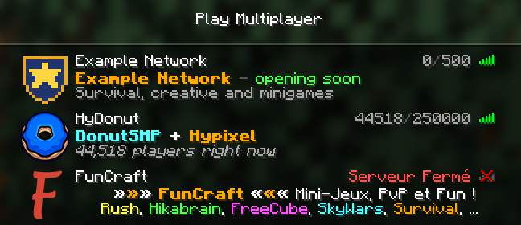

# Examples

Complete configurations, each commented, and loaded by the tests of every
change, so that they always work with the current version.



| Example                                  | What it shows                                                                                            | Features                                |
| ---------------------------------------- | -------------------------------------------------------------------------------------------------------- | --------------------------------------- |
| [`maintenance.yaml`](maintenance.yaml)   | A server under maintenance, with news in the lines shown on hover                                        | Statuses, kick messages                 |
| [`opening-soon.yaml`](opening-soon.yaml) | A network that opens next Saturday, with a countdown in the kick message, greeting each player by name   | `join_script`, times                    |
| [`moved.yaml`](moved.yaml)               | The address that players know, after a move: the live status of the new server, and its new address      | Upstreams, `ping_script`                |
| [`network.yaml`](network.yaml)           | A network: one server per address, a lobby shown from its real status, a staff preview, outdated clients | Rules, upstreams, `script`              |
| [`hydonut.yaml`](hydonut.yaml)           | Hypixel and DonutSMP added up and ranked, with the icon of the busiest                                   | `ping_script`, `join_script`, upstreams |
| [`funcraft.yaml`](funcraft.yaml)         | FunCraft.net since it closed, the server this project was first written for                              | Statuses, legacy codes                  |
| [`behind-proxy.yaml`](behind-proxy.yaml) | Clients behind HAProxy, with their real addresses                                                        | Listeners, PROXY protocol               |

## Running an example

With the container image, with this directory mounted:

```shell
docker run --rm -p 25565:25565 \
  -v "$PWD/examples:/config:ro" -e FMS_CONFIG_FILE=/config/maintenance.yaml \
  ghcr.io/nathan818fr/fake-minecraft-server:v2
```

Or from a clone of the repository, with [mise](https://mise.jdx.dev):

```shell
FMS_CONFIG_FILE=examples/maintenance.yaml mise run dev
```

Then add `localhost` to your server list. `hydonut.yaml` polls Hypixel and
DonutSMP; the other examples with upstreams poll placeholder addresses, which
never answer, so they show their own status until you replace them with your
servers.
